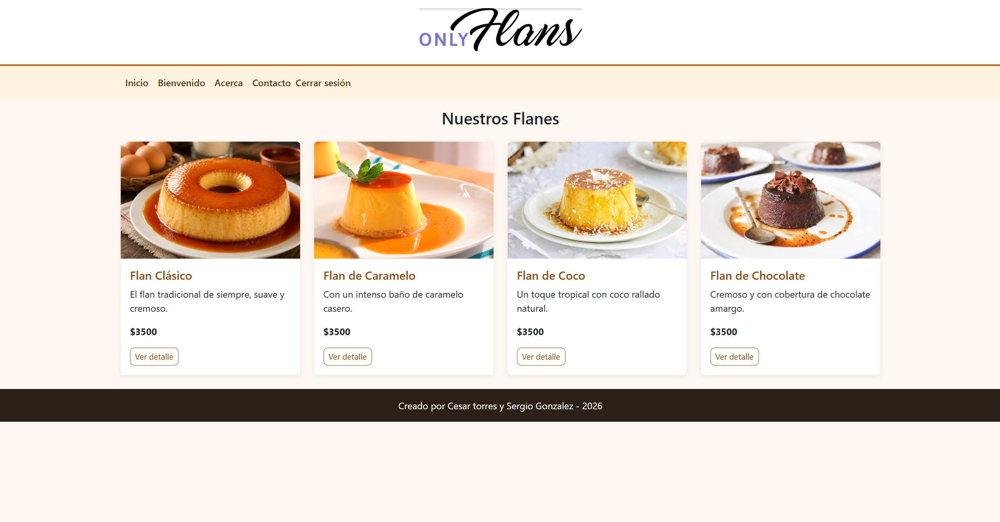
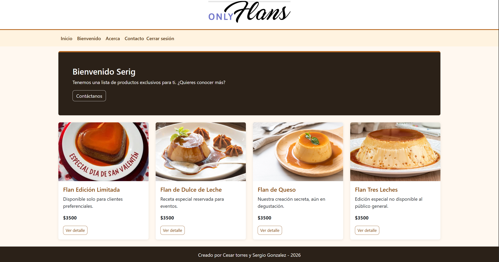
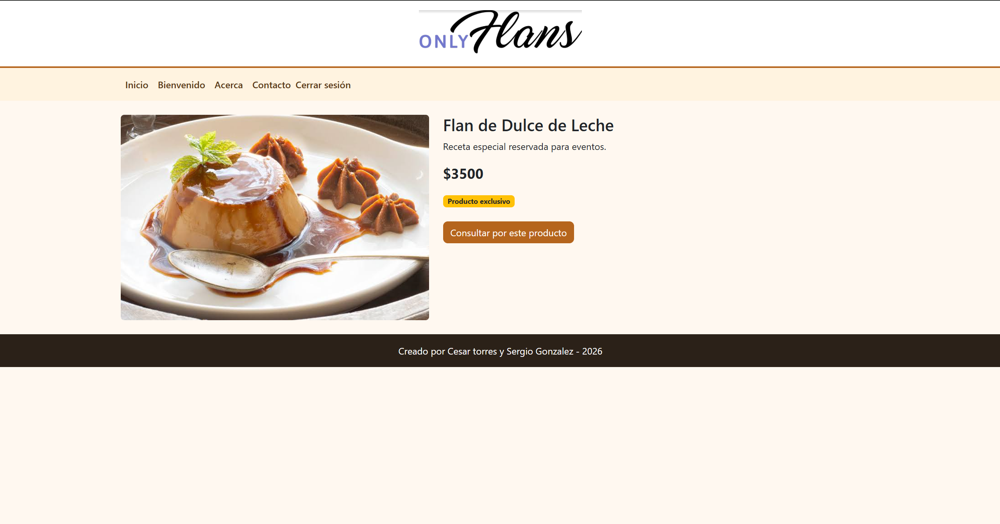

# OnlyFlans 🍮

Sitio web de una tienda de flanes desarrollado con **Django** y **Bootstrap** como parte del módulo de Django del bootcamp Full Stack Python (Talento Digital / SENCE).

Proyecto realizado en pareja por **Sergio González** y **Cesar Torres**.

## Capturas

| Inicio (público) | Bienvenido (con login) | Detalle de un flan |
|---|---|---|
|  |  |  |

## Funcionalidades

- Página de inicio con los flanes públicos, en tarjetas Bootstrap y diseño responsive.
- Páginas "Acerca de" y formulario de contacto (guardado en base de datos, con página de éxito).
- Inicio y cierre de sesión con el sistema de autenticación de Django.
- Zona `/bienvenido` protegida con `login_required`, con los flanes privados y un saludo personalizado.
- Panel de administración para gestionar los flanes y los mensajes de contacto.
- **Mejoras del Hito 4:** precio (CLP) en cada flan y vista de detalle en `/flan/<slug>/`.

## Tecnologías

Python 3 · Django 5.2 · Bootstrap 5 · SQLite · HTML y CSS

## Instalación

```bash
git clone https://github.com/<tu-usuario>/onlyflans.git
cd onlyflans
python -m venv venv
# Windows: venv\Scripts\activate   |   macOS/Linux: source venv/bin/activate
pip install -r requirements.txt
python manage.py migrate
python manage.py loaddata flanes        # carga flanes de ejemplo
python manage.py createsuperuser        # crea tu propio usuario
python manage.py runserver
```

Abre http://127.0.0.1:8000/ en el navegador.

## Pruebas

```bash
python manage.py test
```

## Variables de entorno (opcionales)

| Variable | Uso | Valor por defecto |
|---|---|---|
| `DJANGO_SECRET_KEY` | Clave secreta de Django | clave de desarrollo |
| `DJANGO_DEBUG` | `True` o `False` | `True` |
| `DJANGO_ALLOWED_HOSTS` | Hosts separados por coma | vacío |

## Estructura

```
onlyflans/   configuración del proyecto (settings, urls)
web/         aplicación: modelos, vistas, formularios, plantillas, estáticos y tests
```
